<div align="center">

# Lab 5.1 : Volumes persistants

emptyDir, PVC, provisionnement dynamique et cycle de vie d'un volume


</div>

---

> Cette branche contient uniquement le **Lab 5.1**. L'autre partie est sur la branche [`lab5.2`](https://github.com/Narjess805/lab5-volumes-statefulset/tree/lab5.2), et la vue d'ensemble sur [`main`](https://github.com/Narjess805/lab5-volumes-statefulset/tree/main).

---

## Environnement de travail

| Composant | Détails |
|-----------|---------|
| Cluster | K3s, 3 nœuds `Ready` (1 master + 2 workers) |
| StorageClass | `local-path` (par défaut, fournie par K3s) |
| Images utilisées | `nginx:1.26-alpine`, `postgres:16-alpine`, `busybox:1.36` |
| Namespace | `tp-k8s` |
| Alias | `k` pour `kubectl` |

| Nœud | Rôle | Adresse IP |
|------|------|------------|
| Master | control-plane | `192.168.56.20` |
| Worker 1 | worker | `192.168.56.31` |
| Worker 2 | worker | `192.168.56.32` |

---

## Étapes réalisées et résultats

Des fichiers sont écrits à trois endroits différents, puis on observe lesquels survivent aux incidents.

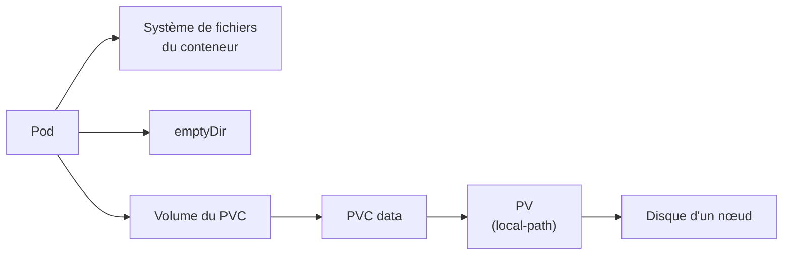

| Emplacement | Survit au redémarrage du conteneur | Survit à la suppression du Pod |
|-------------|:----------------------------------:|:------------------------------:|
| Système de fichiers du conteneur | Non | Non |
| `emptyDir` | **Oui** | Non |
| PVC | **Oui** | **Oui** |

### Étape 1 : Préparer le namespace et examiner la StorageClass

```bash
k create namespace tp-k8s
k config set-context --current --namespace=tp-k8s

k get storageclass
k get storageclass local-path -o yaml | grep -E "reclaimPolicy|volumeBindingMode|is-default-class"
```

> **Résultat** : `local-path` est la classe par défaut. Sa politique de rétention est `Delete` et son mode de liaison `WaitForFirstConsumer` : le volume n'est créé que lorsqu'un Pod utilise le PVC.

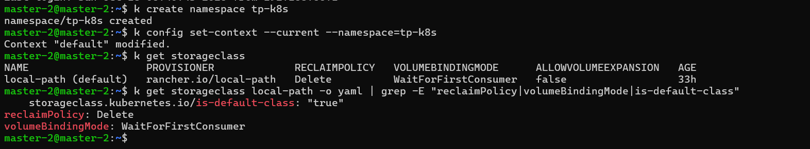

---

### Étape 2 : Perte de données avec emptyDir

```bash
k apply -f lab5.1/yaml/temp.yaml
k wait --for=condition=Ready pod/temp --timeout=60s
k exec temp -- sh -c 'echo "dans emptyDir" > /donnees/fichier.txt; echo "dans le conteneur" > /tmp/ephemere.txt'

# Redémarrage du conteneur
k exec temp -- nginx -s stop
sleep 10
k get pod temp
k exec temp -- ls /donnees /tmp

# Suppression du Pod, puis recréation
k delete pod temp
k apply -f lab5.1/yaml/temp.yaml
k wait --for=condition=Ready pod/temp --timeout=60s
k exec temp -- ls /donnees
k delete pod temp
```

> **Résultat** : après le redémarrage du conteneur (`RESTARTS` passe à 1), `fichier.txt` existe toujours mais `ephemere.txt` a disparu. Après la suppression du Pod, `/donnees` est vide.

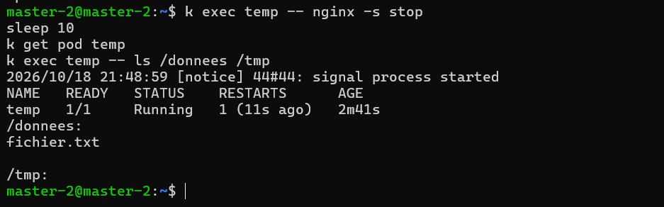

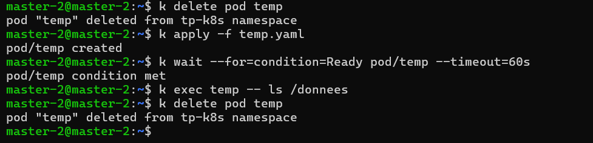

---

### Étape 3 : Créer un PVC

```bash
k apply -f lab5.1/yaml/pvc.yaml
k get pvc,pv
k describe pvc data | tail -n 5
```

> **Résultat** : le PVC reste `Pending` et aucun PV n'existe encore. `describe` indique qu'il attend un premier consommateur (`WaitForFirstConsumer`).

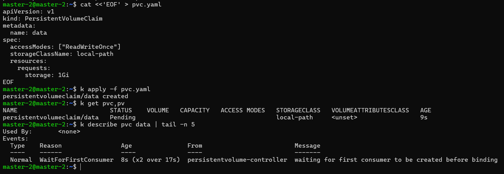

---

### Étape 4 : Utiliser le PVC dans un Pod

```bash
k apply -f lab5.1/yaml/app.yaml
k get pvc -w

k get pvc,pv
k get pod app -o wide
PV=$(k get pvc data -o jsonpath='{.spec.volumeName}')
k describe pv $PV | grep -E -A6 "Node Affinity|Source"

k exec app -- sh -c 'echo "Bonjour, donnee persistante" > /usr/share/nginx/html/index.html'
k exec app -- wget -qO- http://localhost

sudo ls -R /var/lib/rancher/k3s/storage/      # sur le nœud qui héberge le Pod
```

> **Résultat** : le PVC passe de `Pending` à `Bound`, avec un PV créé automatiquement. Ce PV porte une **affinité vers le nœud** du Pod. nginx sert la page, et `index.html` existe dans le dossier de stockage du nœud.

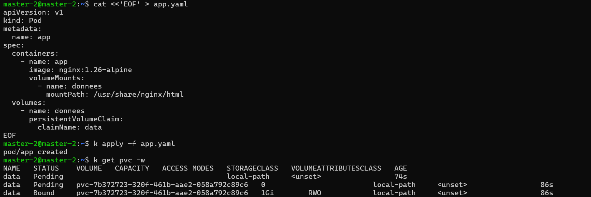

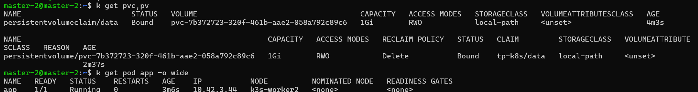

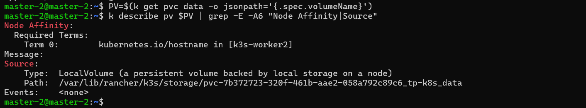

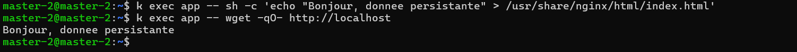

---

### Étape 5 : Prouver la persistance

```bash
k delete pod app
k get pvc
k apply -f lab5.1/yaml/app.yaml
k wait --for=condition=Ready pod/app --timeout=60s
k get pod app -o wide
k exec app -- wget -qO- http://localhost
```

> **Résultat** : le PVC reste `Bound` pendant que le Pod n'existe plus. Le nouveau Pod affiche le **même message** et s'exécute sur le **même nœud**.

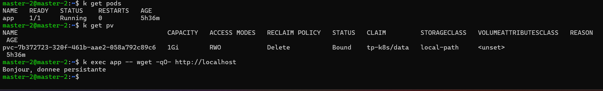

---

### Étape 6 : Supprimer le PVC

```bash
k delete pvc data --wait=false
k get pvc

k delete pod app
sleep 10
k get pvc,pv
sudo ls /var/lib/rancher/k3s/storage/

k apply -f lab5.1/yaml/pvc.yaml
k apply -f lab5.1/yaml/app.yaml
k wait --for=condition=Ready pod/app --timeout=60s
k exec app -- ls /usr/share/nginx/html
```

> **Résultat** : le PVC reste en `Terminating` tant que le Pod l'utilise (protection). Après suppression du Pod, le PVC et le PV disparaissent (rétention `Delete`) et le dossier du nœud est supprimé. Le volume recréé est **vide** : la page précédente est perdue.

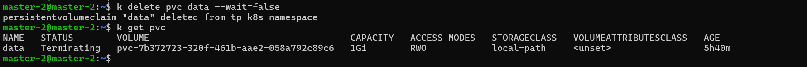

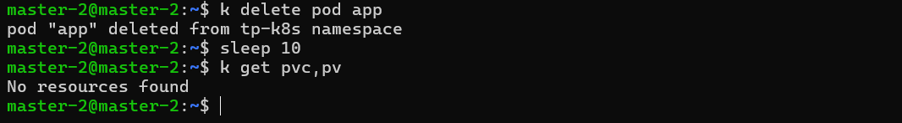

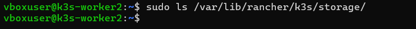

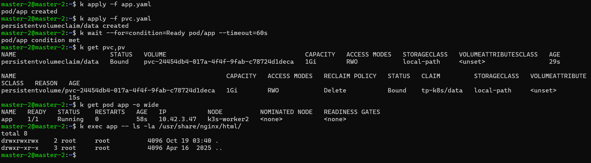

---

### Étape 7 : Diagnostiquer un PVC en Pending

```bash
k apply -f lab5.1/yaml/pvc-erreur.yaml
k get pvc data-erreur
k describe pvc data-erreur | tail -n 5

k delete pvc data-erreur
sed -i 's|local-pat$|local-path|' lab5.1/yaml/pvc-erreur.yaml
k apply -f lab5.1/yaml/pvc-erreur.yaml
k get pvc data-erreur
```

> **Résultat** : les événements indiquent que la StorageClass `local-pat` est introuvable. Le champ `storageClassName` n'étant plus modifiable, le PVC est supprimé puis recréé. Après correction, il reste `Pending` sans erreur : il attend simplement un Pod.

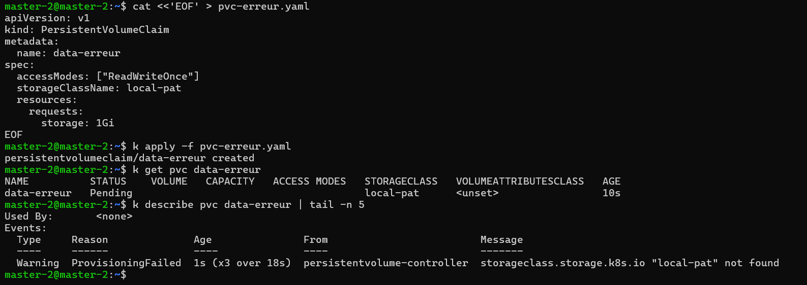

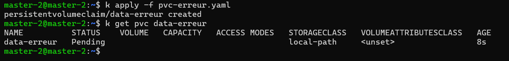

---

### Nettoyage

```bash
k delete namespace tp-k8s
k config set-context --current --namespace=default
k get pv
```

> **Résultat** : `k get pv` ne liste plus aucun volume de ce lab, puisque les PV dynamiques avec rétention `Delete` disparaissent avec leurs PVC.

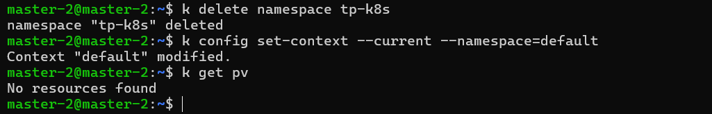

### Questions de réflexion (Lab 5.1)

<details>
<summary><strong>1. Pourquoi le fichier de l'emptyDir a-t-il survécu au redémarrage du conteneur mais pas à la suppression du Pod ?</strong></summary>

Un `emptyDir` est lié au **Pod**, pas au conteneur. Quand le conteneur redémarre, le Pod reste en place et garde son volume. Quand le Pod est supprimé, son `emptyDir` est supprimé avec lui.
</details>

<details>
<summary><strong>2. Pourquoi le Pod recréé a-t-il été placé sur le même nœud ?</strong></summary>

Avec `local-path`, les données sont stockées sur le disque d'un nœud précis. Le PV porte donc une **affinité de nœud** : le scheduler ne peut placer le Pod que sur le nœud où se trouve le volume.
</details>

<details>
<summary><strong>3. Que se passerait-il pour l'application si le nœud hébergeant le volume tombait en panne ?</strong></summary>

Les données seraient inaccessibles tant que le nœud est hors service, et le Pod ne pourrait pas être replanifié ailleurs à cause de l'affinité : il resterait `Pending`. Si le disque était perdu, les données le seraient aussi. Il faut un stockage répliqué ou en réseau, ou des sauvegardes.
</details>

<details>
<summary><strong>4. Pourquoi le PVC est-il resté en Terminating tant que le Pod existait ?</strong></summary>

C'est une **protection** de Kubernetes : un PVC utilisé par un Pod n'est pas supprimé tant que ce Pod existe, afin de ne pas retirer le volume sous une application en cours d'exécution.
</details>

<details>
<summary><strong>5. Quelle précaution prendre avant de supprimer un PVC dont la rétention est Delete ?</strong></summary>

La suppression du PVC entraîne celle du PV **et des données**. Il faut vérifier que c'est le bon PVC, sauvegarder ce qui doit l'être, et choisir la rétention `Retain` pour des données critiques.
</details>

### Dépannage (Lab 5.1)

| Symptôme | Pistes |
|----------|--------|
| PVC `Pending` sans Pod | Normal avec `local-path` : le volume est créé au premier Pod qui l'utilise |
| PVC `Pending` malgré un Pod | `k describe pvc` (Events) : StorageClass absente ou mal orthographiée, quota atteint |
| Pod `Pending` | `k describe pod` : PVC non lié ou nœud du volume indisponible |
| `k exec temp -- nginx -s stop` échoue | Pod pas encore prêt ; utiliser `k wait` ou réessayer ; à défaut, `k exec temp -- kill 1` |
| `RESTARTS` reste à 0 | Attendre 10 à 15 secondes puis relancer `k get pod temp` |
| `wget` : connexion refusée | nginx redémarre : patienter quelques secondes |
| Dossier absent dans `/var/lib/rancher/k3s/storage/` | Mauvais nœud : relever le nœud avec `k get pod app -o wide` |
| `k wait` expire | Image en cours de téléchargement : `k describe pod`, accès Internet des VMs |


---

## Auteur

| | |
|---|---|
| **Nom** | Dabbech |
| **Prénom** | Narjess |
| **Classe** | M2 DevOps |
| **GitHub** | [@Narjess805](https://github.com/Narjess805) |
| **Date** | Octobre 2026 |
