<div align="center">

# Lab 5.2 : Base de données avec StatefulSet

PostgreSQL, Service headless, un volume par Pod et persistance des données


</div>

---

> Cette branche contient uniquement le **Lab 5.2**. L'autre partie est sur la branche [`lab5.1`](https://github.com/Narjess805/lab5-volumes-statefulset/tree/lab5.1), et la vue d'ensemble sur [`main`](https://github.com/Narjess805/lab5-volumes-statefulset/tree/main).

---

## Environnement de travail

| Composant | Détails |
|-----------|---------|
| Cluster | K3s, 3 nœuds `Ready` (1 master + 2 workers) |
| StorageClass | `local-path` (par défaut, fournie par K3s) |
| Images utilisées | `nginx:1.26-alpine`, `postgres:16-alpine`, `busybox:1.36` |
| Namespace | `tp-k8s` |
| Alias | `k` pour `kubectl` |

| Nœud | Rôle | Adresse IP |
|------|------|------------|
| Master | control-plane | `192.168.56.20` |
| Worker 1 | worker | `192.168.56.31` |
| Worker 2 | worker | `192.168.56.32` |

---

## Étapes réalisées et résultats

La base de données d'une future application doit conserver ses données et rester joignable par un **nom stable**.

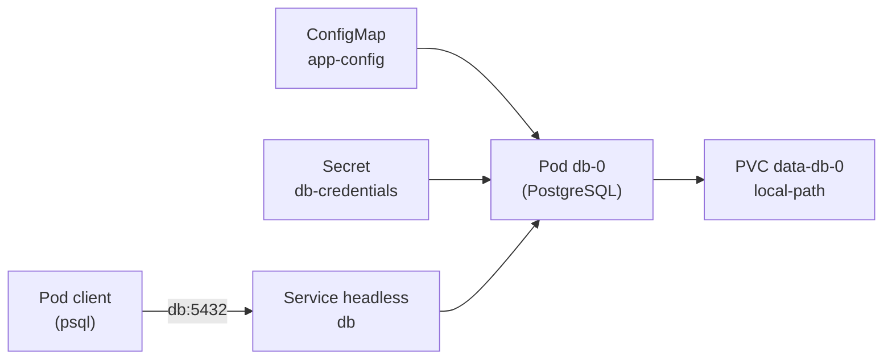

| Ressource | Rôle |
|-----------|------|
| **ConfigMap** `app-config` | Nom de la base (`DB_NAME`), hôte et port |
| **Secret** `db-credentials` | Utilisateur et mot de passe PostgreSQL |
| **Service headless** `db` | `clusterIP: None` : le DNS renvoie directement les adresses des Pods |
| **StatefulSet** `db` | Pods à identité stable (`db-0`, `db-1`) |
| **PVC** `data-db-0` | Volume dédié à `db-0`, créé par `volumeClaimTemplates` |

### Étape 1 : Préparer la configuration

```bash
k create namespace tp-k8s
k config set-context --current --namespace=tp-k8s

k apply -f lab5.2/yaml/app-config.yaml
k create secret generic db-credentials \
  --from-literal=POSTGRES_USER=appuser \
  --from-literal=POSTGRES_PASSWORD='ChangeMe-123'
k get configmap,secret
```

> **Résultat** : le ConfigMap `app-config` et le Secret `db-credentials` existent. Le Secret est créé en ligne de commande : seul le modèle `secret.example.yaml` (fausses valeurs) est versionné.

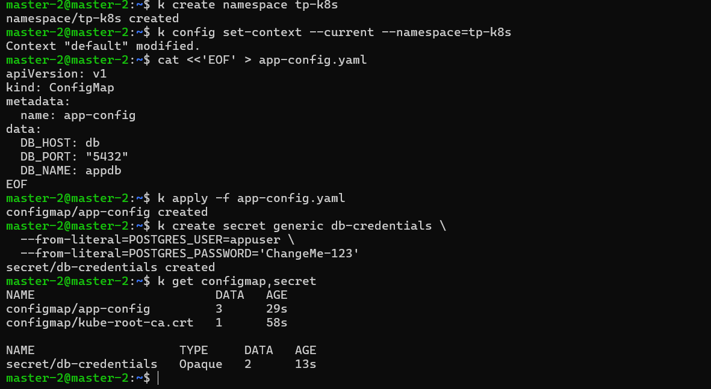

---

### Étape 2 : Déployer la base avec un StatefulSet

```bash
k apply -f lab5.2/yaml/db.yaml
k get pods -w

k get statefulset,service,pvc,pv
k logs db-0 | tail -n 5
k exec db-0 -- pg_isready -U appuser -d appdb
```

> **Résultat** : le Pod s'appelle `db-0`, le PVC `data-db-0` est `Bound` à un PV, `pg_isready` répond `accepting connections` et les logs indiquent que le système est prêt à accepter des connexions.

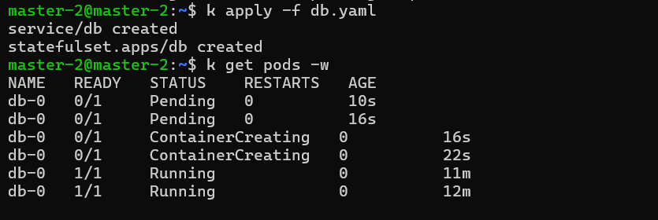

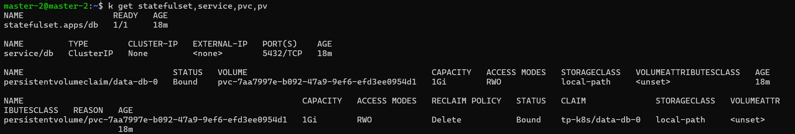

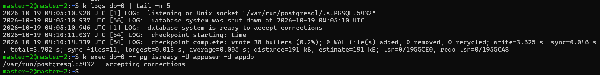

> **Note** : la variable `PGDATA` place les fichiers dans un sous-dossier (`pgdata`) du point de montage, car la racine du volume peut déjà contenir des éléments. Le Pod est déclaré prêt dès que son conteneur démarre : l'état réel de la base se vérifie avec `pg_isready` (les sondes de disponibilité sont vues au chapitre 9).

---

### Étape 3 : Créer des données

```bash
k exec db-0 -- psql -U appuser -d appdb -c "CREATE TABLE taches (id serial PRIMARY KEY, titre text NOT NULL, faite boolean DEFAULT false);"
k exec db-0 -- psql -U appuser -d appdb -c "INSERT INTO taches (titre) VALUES ('Apprendre les StatefulSets'), ('Tester la persistance');"
k exec db-0 -- psql -U appuser -d appdb -c "SELECT * FROM taches;"
```

> **Résultat** : la requête `SELECT` renvoie deux lignes.

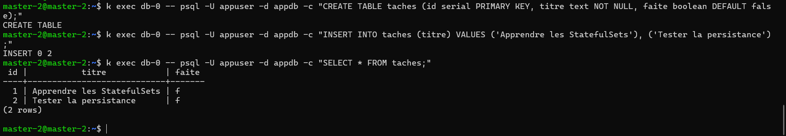

---

### Étape 4 : Prouver la persistance

```bash
k get pod db-0 -o wide
k delete pod db-0
k get pods -w

k exec db-0 -- pg_isready -U appuser -d appdb
k exec db-0 -- psql -U appuser -d appdb -c "SELECT * FROM taches;"
k get pod db-0 -o wide
k get pvc
```

> **Résultat** : le Pod recréé porte le **même nom** `db-0`, s'exécute sur le même nœud avec le même PVC `data-db-0`, et les deux lignes sont toujours présentes.

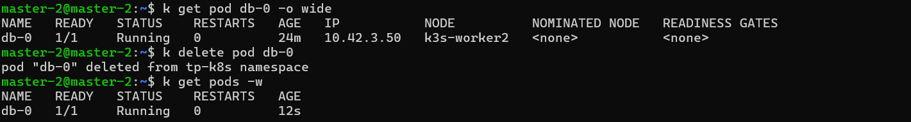

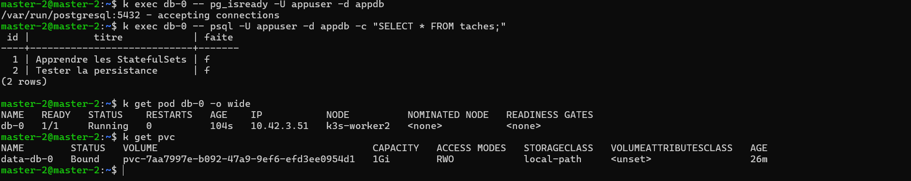

---

### Étape 5 : Joindre la base par son nom DNS

```bash
k run test --rm -it --image=busybox:1.36 --restart=Never -- nslookup db
k run test --rm -it --image=busybox:1.36 --restart=Never -- nslookup db-0.db

k run client --rm -it --image=postgres:16-alpine --restart=Never \
  --env="PGPASSWORD=ChangeMe-123" -- \
  psql -h db -U appuser -d appdb -c "SELECT count(*) FROM taches;"
```

> **Résultat** : `nslookup db` renvoie directement l'adresse IP du Pod `db-0` (pas d'adresse de Service virtuelle) : c'est la particularité d'un Service headless. Le client se connecte avec le nom `db` et obtient `2`.

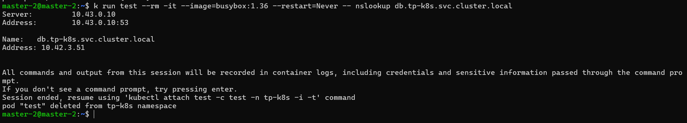

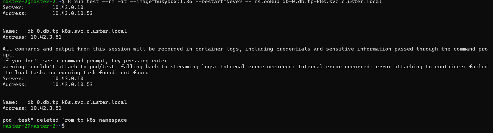

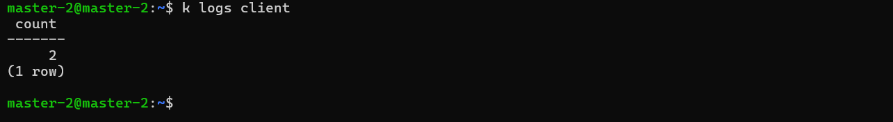

> **Attention** : passer un mot de passe en ligne de commande est acceptable pour un TP, mais à éviter ailleurs : il reste visible dans l'historique et dans la définition du Pod.

---

### Étape 6 : Passer à deux réplicas

```bash
k scale statefulset db --replicas=2
k get pods -w

k get pvc
k exec db-1 -- psql -U appuser -d appdb -c "\dt"
k exec db-0 -- psql -U appuser -d appdb -c "\dt"

k scale statefulset db --replicas=1
k get pods
k get pvc
k delete pvc data-db-1
k get pvc
```

> **Résultat** : `db-1` démarre **après** que `db-0` est prêt, avec son propre PVC `data-db-1`. Sa base est vide : les deux réplicas ne sont pas synchronisés. Après réduction à un réplica, `data-db-1` subsiste jusqu'à sa suppression manuelle.

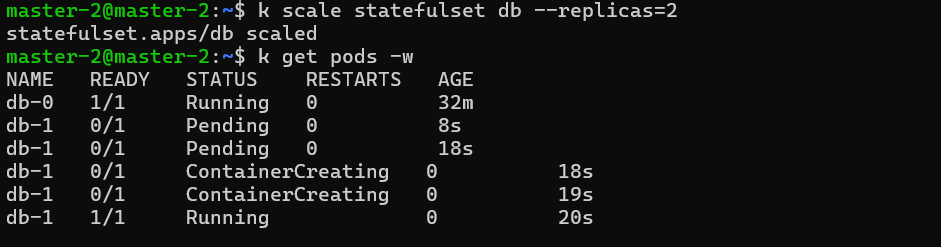

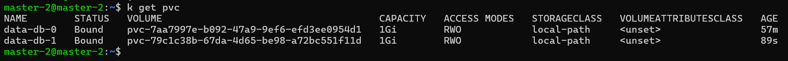

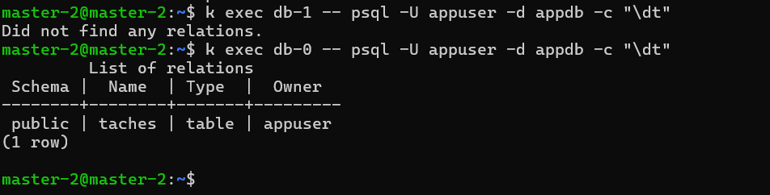

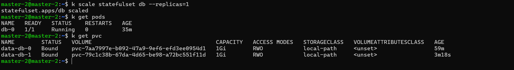

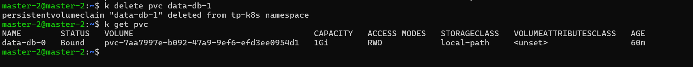

---

### Étape 7 : Comprendre le rôle du mot de passe initial

```bash
k create secret generic db-credentials \
  --from-literal=POSTGRES_USER=appuser \
  --from-literal=POSTGRES_PASSWORD='Nouveau-456' \
  --dry-run=client -o yaml | k apply -f -
k rollout restart statefulset db
k rollout status statefulset db
k exec db-0 -- pg_isready -U appuser -d appdb

k run client --rm -it --image=postgres:16-alpine --restart=Never \
  --env="PGPASSWORD=Nouveau-456" -- psql -h db -U appuser -d appdb -c "SELECT 1;"
k run client --rm -it --image=postgres:16-alpine --restart=Never \
  --env="PGPASSWORD=ChangeMe-123" -- psql -h db -U appuser -d appdb -c "SELECT 1;"
```

| Mot de passe testé | Résultat |
|--------------------|----------|
| `Nouveau-456` (nouveau Secret) | **Refusé** |
| `ChangeMe-123` (mot de passe initial) | **Accepté** |

> **Résultat** : `db-0` redémarre avec ses données intactes. PostgreSQL ne lit `POSTGRES_PASSWORD` qu'à la **première initialisation d'un volume vide** : ensuite, le mot de passe est enregistré dans la base et se change avec une commande SQL.

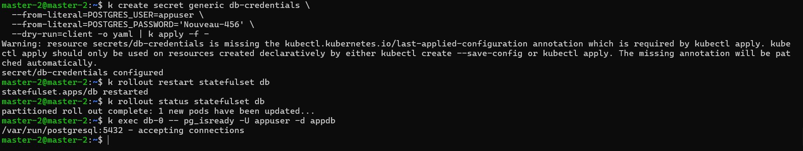

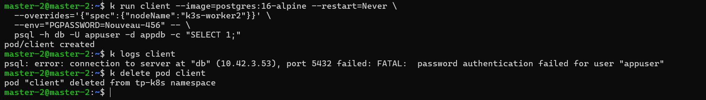

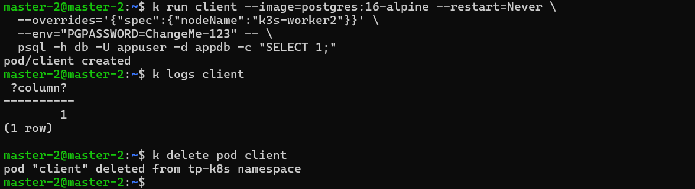

---

### Nettoyage

```bash
k delete namespace tp-k8s
k config set-context --current --namespace=default
k get pv
```

> **Résultat** : la suppression du namespace supprime aussi les PVC, et les PV `local-path` disparaissent avec eux : `k get pv` ne liste aucun volume de ce lab.

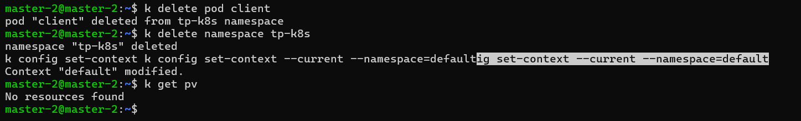

### Questions de réflexion (Lab 5.2)

<details>
<summary><strong>1. Pourquoi le Pod recréé s'appelle-t-il encore db-0 et retrouve-t-il ses données ?</strong></summary>

Un StatefulSet donne à ses Pods une **identité stable** (nom et volume associé). Quand `db-0` est supprimé, un Pod de même nom est créé et rattaché au même PVC `data-db-0`.
</details>

<details>
<summary><strong>2. Quelle est la particularité d'un Service headless et pourquoi le préfère-t-on pour un StatefulSet ?</strong></summary>

Il n'a pas d'adresse virtuelle : le DNS renvoie directement les adresses des Pods, et chaque Pod a un nom DNS stable (`db-0.db`). C'est utile quand on doit distinguer les membres d'un groupe, par exemple une base répliquée.
</details>

<details>
<summary><strong>3. Pourquoi la table taches n'existait-elle pas dans db-1 ?</strong></summary>

Un StatefulSet **ne réplique pas les données** : chaque Pod a son propre volume et sa propre base. La réplication doit être configurée dans la base elle-même.
</details>

<details>
<summary><strong>4. Pourquoi le PVC data-db-1 a-t-il subsisté après la réduction à un réplica ?</strong></summary>

Kubernetes ne supprime pas automatiquement les PVC d'un StatefulSet, pour éviter de détruire des données par erreur. Il faut les supprimer explicitement.
</details>

<details>
<summary><strong>5. Pourquoi le changement du mot de passe dans le Secret n'a-t-il pas modifié le mot de passe de la base ?</strong></summary>

`POSTGRES_PASSWORD` n'est utilisée qu'à la création de la base, sur un volume vide. Une fois la base initialisée, le mot de passe est conservé dans ses données : il faut le modifier avec SQL (`ALTER USER`).
</details>

### Dépannage (Lab 5.2)

| Symptôme | Pistes |
|----------|--------|
| `db-0` en `CrashLoopBackOff` | `k logs db-0` : variable manquante, `PGDATA`, droits sur le volume |
| `CreateContainerConfigError` | Secret ou ConfigMap introuvable, nom de clé incorrect : `k describe pod db-0` |
| PVC `Pending` | `k describe pvc data-db-0` : StorageClass, quota atteint ; vérifier que le Pod existe |
| `pg_isready` : no response | PostgreSQL démarre encore : patienter quelques secondes puis relancer |
| `psql: FATAL: role "..." does not exist` | Nom d'utilisateur différent de `POSTGRES_USER`, ou volume initialisé avec d'anciennes valeurs |
| `password authentication failed` | Mot de passe différent de celui utilisé à l'initialisation du volume |
| `nslookup db` ne renvoie rien | Service `db` absent ou sélecteur incorrect : `k get svc db`, `k get endpoints db` |
| `db-1` reste `Pending` | Attendre que `db-0` soit prêt ; vérifier les ressources du nœud (`k describe pod db-1`) |


---

## Auteur

| | |
|---|---|
| **Nom** | Dabbech |
| **Prénom** | Narjess |
| **Classe** | M2 DevOps |
| **GitHub** | [@Narjess805](https://github.com/Narjess805) |
| **Date** | Octobre 2026 |
