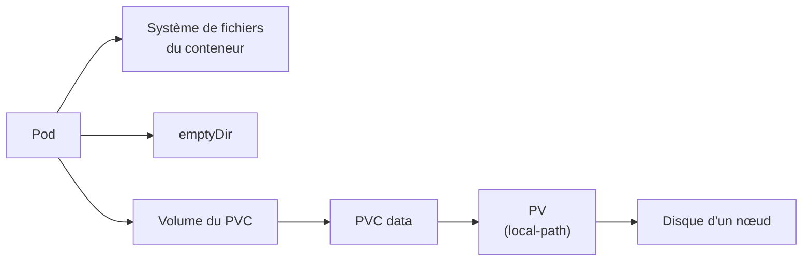
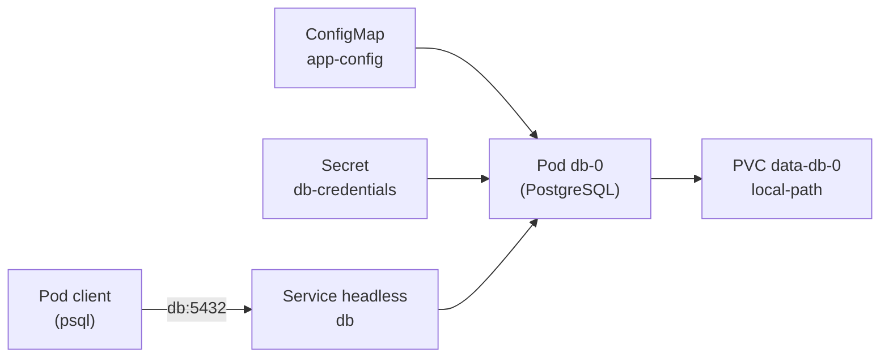

<div align="center">

# Lab 5 : Stockage persistant sur Kubernetes (K3s)

Volumes, PVC, StatefulSet, Service headless et base de données PostgreSQL


</div>

---

## Table des matières

1. [Présentation](#1-présentation)
2. [Environnement de travail](#2-environnement-de-travail)
3. [Structure du dépôt](#3-structure-du-dépôt)
4. [Partie 1 Volumes persistants (Lab 5.1)](#4-partie-1-volumes-persistants-lab-51)
5. [Partie 2 StatefulSet PostgreSQL (Lab 5.2)](#5-partie-2-statefulset-postgresql-lab-52)
6. [Bonnes pratiques retenues](#6-bonnes-pratiques-retenues)
7. [Auteur](#7-auteur)

---

## 1. Présentation

Ce dépôt regroupe les deux labs du chapitre 5, qui portent sur la **conservation des données** d'une application déployée sur Kubernetes.

| Partie | Lab | Thème | Objectif principal |
|:------:|-----|-------|--------------------|
| 1 | **Lab 5.1** | Volumes persistants | Comparer où survivent les données (conteneur, `emptyDir`, PVC), comprendre le provisionnement dynamique et le cycle de vie d'un PVC |
| 2 | **Lab 5.2** | Base de données avec StatefulSet | Déployer PostgreSQL avec un StatefulSet, un Service headless et un volume par Pod, puis prouver la persistance |

Chaque partie est aussi disponible sur sa propre branche : [`lab5.1`](https://github.com/Narjess805/lab5-volumes-statefulset/tree/lab5.1) et [`lab5.2`](https://github.com/Narjess805/lab5-volumes-statefulset/tree/lab5.2). La branche `main` contient l'ensemble.

La base du Lab 5.2 sera réutilisée dans le Mini-projet 2.

## 2. Environnement de travail

| Composant | Détails |
|-----------|---------|
| Cluster | K3s, 3 nœuds `Ready` (1 master + 2 workers) |
| StorageClass | `local-path` (par défaut, fournie par K3s) |
| Images utilisées | `nginx:1.26-alpine`, `postgres:16-alpine`, `busybox:1.36` |
| Namespace | `tp-k8s` |
| Alias | `k` pour `kubectl` |

| Nœud | Rôle | Adresse IP |
|------|------|------------|
| Master | control-plane | `192.168.56.20` |
| Worker 1 | worker | `192.168.56.31` |
| Worker 2 | worker | `192.168.56.32` |

## 3. Structure du dépôt

```text
.
├── README.md                          # Ce fichier
├── .gitignore                         # Exclut les vrais secrets (secret.yaml)
├── lab5.1/                            # Partie 1 : volumes persistants
│   ├── yaml/
│   │   ├── temp.yaml                  # Pod avec emptyDir
│   │   ├── pvc.yaml                   # PersistentVolumeClaim data
│   │   ├── app.yaml                   # Pod nginx monté sur le PVC
│   │   └── pvc-erreur.yaml            # PVC avec une StorageClass erronée
│   └── captures/                      # Preuves d'exécution du Lab 5.1 (16)
│       ├── 01_storageclass.png
│       ├── 02_restart_conteneur.png
│       ├── 03_emptydir_perdu.png
│       ├── 04_pvc_pending.png
│       ├── 05_pending_vers_bound.png
│       ├── 06_pvc_bound_pv_noeud.png
│       ├── 07_pv_node_affinity.png
│       ├── 08_nginx_page_servie.png
│       ├── 09_meme_noeud_meme_message.png
│       ├── 10_pvc_terminating.png
│       ├── 11_pvc_pv_disparus.png
│       ├── 12_dossier_supprime.png
│       ├── 13_volume_vide.png
│       ├── 14_storageclass_introuvable.png
│       ├── 15_pvc_pending_sans_erreur.png
│       └── 16_aucun_pv_nettoyage.png
└── lab5.2/                            # Partie 2 : StatefulSet PostgreSQL
    ├── yaml/
    │   ├── app-config.yaml            # ConfigMap app-config
    │   ├── secret.example.yaml        # Modèle de Secret (fausses valeurs)
    │   └── db.yaml                    # Service headless + StatefulSet db
    └── captures/                      # Preuves d'exécution du Lab 5.2 (19)
        ├── 01_configmap_secret.png
        ├── 02_creation_db0.png
        ├── 03_sts_svc_pvc_pv.png
        ├── 04_logs_pg_isready.png
        ├── 05_select_deux_lignes.png
        ├── 06_db0_recree.png
        ├── 07_persistance_db0.png
        ├── 08_nslookup_db.png
        ├── 09_nslookup_db0_db.png
        ├── 10_client_count_2.png
        ├── 11_db1_apres_db0.png
        ├── 12_deux_pvc_distincts.png
        ├── 13_db1_vide_db0_plein.png
        ├── 14_pvc_db1_subsiste.png
        ├── 15_pvc_db1_supprime.png
        ├── 16_rollout_ok.png
        ├── 17_nouveau_mdp_refuse.png
        ├── 18_ancien_mdp_accepte.png
        └── 19_nettoyage_aucun_pv.png
```

---

## 4. Partie 1 Volumes persistants (Lab 5.1)

Des fichiers sont écrits à trois endroits différents, puis on observe lesquels survivent aux incidents.



| Emplacement | Survit au redémarrage du conteneur | Survit à la suppression du Pod |
|-------------|:----------------------------------:|:------------------------------:|
| Système de fichiers du conteneur | Non | Non |
| `emptyDir` | **Oui** | Non |
| PVC | **Oui** | **Oui** |

### Étape 1 : Préparer le namespace et examiner la StorageClass

```bash
k create namespace tp-k8s
k config set-context --current --namespace=tp-k8s

k get storageclass
k get storageclass local-path -o yaml | grep -E "reclaimPolicy|volumeBindingMode|is-default-class"
```

> **Résultat** : `local-path` est la classe par défaut. Sa politique de rétention est `Delete` et son mode de liaison `WaitForFirstConsumer` : le volume n'est créé que lorsqu'un Pod utilise le PVC.


---

### Étape 2 : Perte de données avec emptyDir

```bash
k apply -f lab5.1/yaml/temp.yaml
k wait --for=condition=Ready pod/temp --timeout=60s
k exec temp -- sh -c 'echo "dans emptyDir" > /donnees/fichier.txt; echo "dans le conteneur" > /tmp/ephemere.txt'

# Redémarrage du conteneur
k exec temp -- nginx -s stop
sleep 10
k get pod temp
k exec temp -- ls /donnees /tmp

# Suppression du Pod, puis recréation
k delete pod temp
k apply -f lab5.1/yaml/temp.yaml
k wait --for=condition=Ready pod/temp --timeout=60s
k exec temp -- ls /donnees
k delete pod temp
```

> **Résultat** : après le redémarrage du conteneur (`RESTARTS` passe à 1), `fichier.txt` existe toujours mais `ephemere.txt` a disparu. Après la suppression du Pod, `/donnees` est vide.


---

### Étape 3 : Créer un PVC

```bash
k apply -f lab5.1/yaml/pvc.yaml
k get pvc,pv
k describe pvc data | tail -n 5
```

> **Résultat** : le PVC reste `Pending` et aucun PV n'existe encore. `describe` indique qu'il attend un premier consommateur (`WaitForFirstConsumer`).


---

### Étape 4 : Utiliser le PVC dans un Pod

```bash
k apply -f lab5.1/yaml/app.yaml
k get pvc -w

k get pvc,pv
k get pod app -o wide
PV=$(k get pvc data -o jsonpath='{.spec.volumeName}')
k describe pv $PV | grep -E -A6 "Node Affinity|Source"

k exec app -- sh -c 'echo "Bonjour, donnee persistante" > /usr/share/nginx/html/index.html'
k exec app -- wget -qO- http://localhost

sudo ls -R /var/lib/rancher/k3s/storage/      # sur le nœud qui héberge le Pod
```

> **Résultat** : le PVC passe de `Pending` à `Bound`, avec un PV créé automatiquement. Ce PV porte une **affinité vers le nœud** du Pod. nginx sert la page, et `index.html` existe dans le dossier de stockage du nœud.


---

### Étape 5 : Prouver la persistance

```bash
k delete pod app
k get pvc
k apply -f lab5.1/yaml/app.yaml
k wait --for=condition=Ready pod/app --timeout=60s
k get pod app -o wide
k exec app -- wget -qO- http://localhost
```

> **Résultat** : le PVC reste `Bound` pendant que le Pod n'existe plus. Le nouveau Pod affiche le **même message** et s'exécute sur le **même nœud**.


---

### Étape 6 : Supprimer le PVC

```bash
k delete pvc data --wait=false
k get pvc

k delete pod app
sleep 10
k get pvc,pv
sudo ls /var/lib/rancher/k3s/storage/

k apply -f lab5.1/yaml/pvc.yaml
k apply -f lab5.1/yaml/app.yaml
k wait --for=condition=Ready pod/app --timeout=60s
k exec app -- ls /usr/share/nginx/html
```

> **Résultat** : le PVC reste en `Terminating` tant que le Pod l'utilise (protection). Après suppression du Pod, le PVC et le PV disparaissent (rétention `Delete`) et le dossier du nœud est supprimé. Le volume recréé est **vide** : la page précédente est perdue.


---

### Étape 7 : Diagnostiquer un PVC en Pending

```bash
k apply -f lab5.1/yaml/pvc-erreur.yaml
k get pvc data-erreur
k describe pvc data-erreur | tail -n 5

k delete pvc data-erreur
sed -i 's|local-pat$|local-path|' lab5.1/yaml/pvc-erreur.yaml
k apply -f lab5.1/yaml/pvc-erreur.yaml
k get pvc data-erreur
```

> **Résultat** : les événements indiquent que la StorageClass `local-pat` est introuvable. Le champ `storageClassName` n'étant plus modifiable, le PVC est supprimé puis recréé. Après correction, il reste `Pending` sans erreur : il attend simplement un Pod.


---

### Nettoyage

```bash
k delete namespace tp-k8s
k config set-context --current --namespace=default
k get pv
```

> **Résultat** : `k get pv` ne liste plus aucun volume de ce lab, puisque les PV dynamiques avec rétention `Delete` disparaissent avec leurs PVC.


### Questions de réflexion (Lab 5.1)

<details>
<summary><strong>1. Pourquoi le fichier de l'emptyDir a-t-il survécu au redémarrage du conteneur mais pas à la suppression du Pod ?</strong></summary>

Un `emptyDir` est lié au **Pod**, pas au conteneur. Quand le conteneur redémarre, le Pod reste en place et garde son volume. Quand le Pod est supprimé, son `emptyDir` est supprimé avec lui.
</details>

<details>
<summary><strong>2. Pourquoi le Pod recréé a-t-il été placé sur le même nœud ?</strong></summary>

Avec `local-path`, les données sont stockées sur le disque d'un nœud précis. Le PV porte donc une **affinité de nœud** : le scheduler ne peut placer le Pod que sur le nœud où se trouve le volume.
</details>

<details>
<summary><strong>3. Que se passerait-il pour l'application si le nœud hébergeant le volume tombait en panne ?</strong></summary>

Les données seraient inaccessibles tant que le nœud est hors service, et le Pod ne pourrait pas être replanifié ailleurs à cause de l'affinité : il resterait `Pending`. Si le disque était perdu, les données le seraient aussi. Il faut un stockage répliqué ou en réseau, ou des sauvegardes.
</details>

<details>
<summary><strong>4. Pourquoi le PVC est-il resté en Terminating tant que le Pod existait ?</strong></summary>

C'est une **protection** de Kubernetes : un PVC utilisé par un Pod n'est pas supprimé tant que ce Pod existe, afin de ne pas retirer le volume sous une application en cours d'exécution.
</details>

<details>
<summary><strong>5. Quelle précaution prendre avant de supprimer un PVC dont la rétention est Delete ?</strong></summary>

La suppression du PVC entraîne celle du PV **et des données**. Il faut vérifier que c'est le bon PVC, sauvegarder ce qui doit l'être, et choisir la rétention `Retain` pour des données critiques.
</details>

### Dépannage (Lab 5.1)

| Symptôme | Pistes |
|----------|--------|
| PVC `Pending` sans Pod | Normal avec `local-path` : le volume est créé au premier Pod qui l'utilise |
| PVC `Pending` malgré un Pod | `k describe pvc` (Events) : StorageClass absente ou mal orthographiée, quota atteint |
| Pod `Pending` | `k describe pod` : PVC non lié ou nœud du volume indisponible |
| `k exec temp -- nginx -s stop` échoue | Pod pas encore prêt ; utiliser `k wait` ou réessayer ; à défaut, `k exec temp -- kill 1` |
| `RESTARTS` reste à 0 | Attendre 10 à 15 secondes puis relancer `k get pod temp` |
| `wget` : connexion refusée | nginx redémarre : patienter quelques secondes |
| Dossier absent dans `/var/lib/rancher/k3s/storage/` | Mauvais nœud : relever le nœud avec `k get pod app -o wide` |
| `k wait` expire | Image en cours de téléchargement : `k describe pod`, accès Internet des VMs |

---

## 5. Partie 2 StatefulSet PostgreSQL (Lab 5.2)

La base de données d'une future application doit conserver ses données et rester joignable par un **nom stable**.



| Ressource | Rôle |
|-----------|------|
| **ConfigMap** `app-config` | Nom de la base (`DB_NAME`), hôte et port |
| **Secret** `db-credentials` | Utilisateur et mot de passe PostgreSQL |
| **Service headless** `db` | `clusterIP: None` : le DNS renvoie directement les adresses des Pods |
| **StatefulSet** `db` | Pods à identité stable (`db-0`, `db-1`) |
| **PVC** `data-db-0` | Volume dédié à `db-0`, créé par `volumeClaimTemplates` |

### Étape 1 : Préparer la configuration

```bash
k create namespace tp-k8s
k config set-context --current --namespace=tp-k8s

k apply -f lab5.2/yaml/app-config.yaml
k create secret generic db-credentials \
  --from-literal=POSTGRES_USER=appuser \
  --from-literal=POSTGRES_PASSWORD='ChangeMe-123'
k get configmap,secret
```

> **Résultat** : le ConfigMap `app-config` et le Secret `db-credentials` existent. Le Secret est créé en ligne de commande : seul le modèle `secret.example.yaml` (fausses valeurs) est versionné.


---

### Étape 2 : Déployer la base avec un StatefulSet

```bash
k apply -f lab5.2/yaml/db.yaml
k get pods -w

k get statefulset,service,pvc,pv
k logs db-0 | tail -n 5
k exec db-0 -- pg_isready -U appuser -d appdb
```

> **Résultat** : le Pod s'appelle `db-0`, le PVC `data-db-0` est `Bound` à un PV, `pg_isready` répond `accepting connections` et les logs indiquent que le système est prêt à accepter des connexions.


> **Note** : la variable `PGDATA` place les fichiers dans un sous-dossier (`pgdata`) du point de montage, car la racine du volume peut déjà contenir des éléments. Le Pod est déclaré prêt dès que son conteneur démarre : l'état réel de la base se vérifie avec `pg_isready` (les sondes de disponibilité sont vues au chapitre 9).

---

### Étape 3 : Créer des données

```bash
k exec db-0 -- psql -U appuser -d appdb -c "CREATE TABLE taches (id serial PRIMARY KEY, titre text NOT NULL, faite boolean DEFAULT false);"
k exec db-0 -- psql -U appuser -d appdb -c "INSERT INTO taches (titre) VALUES ('Apprendre les StatefulSets'), ('Tester la persistance');"
k exec db-0 -- psql -U appuser -d appdb -c "SELECT * FROM taches;"
```

> **Résultat** : la requête `SELECT` renvoie deux lignes.


---

### Étape 4 : Prouver la persistance

```bash
k get pod db-0 -o wide
k delete pod db-0
k get pods -w

k exec db-0 -- pg_isready -U appuser -d appdb
k exec db-0 -- psql -U appuser -d appdb -c "SELECT * FROM taches;"
k get pod db-0 -o wide
k get pvc
```

> **Résultat** : le Pod recréé porte le **même nom** `db-0`, s'exécute sur le même nœud avec le même PVC `data-db-0`, et les deux lignes sont toujours présentes.


---

### Étape 5 : Joindre la base par son nom DNS

```bash
k run test --rm -it --image=busybox:1.36 --restart=Never -- nslookup db
k run test --rm -it --image=busybox:1.36 --restart=Never -- nslookup db-0.db

k run client --rm -it --image=postgres:16-alpine --restart=Never \
  --env="PGPASSWORD=ChangeMe-123" -- \
  psql -h db -U appuser -d appdb -c "SELECT count(*) FROM taches;"
```

> **Résultat** : `nslookup db` renvoie directement l'adresse IP du Pod `db-0` (pas d'adresse de Service virtuelle) : c'est la particularité d'un Service headless. Le client se connecte avec le nom `db` et obtient `2`.


> **Attention** : passer un mot de passe en ligne de commande est acceptable pour un TP, mais à éviter ailleurs : il reste visible dans l'historique et dans la définition du Pod.

---

### Étape 6 : Passer à deux réplicas

```bash
k scale statefulset db --replicas=2
k get pods -w

k get pvc
k exec db-1 -- psql -U appuser -d appdb -c "\dt"
k exec db-0 -- psql -U appuser -d appdb -c "\dt"

k scale statefulset db --replicas=1
k get pods
k get pvc
k delete pvc data-db-1
k get pvc
```

> **Résultat** : `db-1` démarre **après** que `db-0` est prêt, avec son propre PVC `data-db-1`. Sa base est vide : les deux réplicas ne sont pas synchronisés. Après réduction à un réplica, `data-db-1` subsiste jusqu'à sa suppression manuelle.


---

### Étape 7 : Comprendre le rôle du mot de passe initial

```bash
k create secret generic db-credentials \
  --from-literal=POSTGRES_USER=appuser \
  --from-literal=POSTGRES_PASSWORD='Nouveau-456' \
  --dry-run=client -o yaml | k apply -f -
k rollout restart statefulset db
k rollout status statefulset db
k exec db-0 -- pg_isready -U appuser -d appdb

k run client --rm -it --image=postgres:16-alpine --restart=Never \
  --env="PGPASSWORD=Nouveau-456" -- psql -h db -U appuser -d appdb -c "SELECT 1;"
k run client --rm -it --image=postgres:16-alpine --restart=Never \
  --env="PGPASSWORD=ChangeMe-123" -- psql -h db -U appuser -d appdb -c "SELECT 1;"
```

| Mot de passe testé | Résultat |
|--------------------|----------|
| `Nouveau-456` (nouveau Secret) | **Refusé** |
| `ChangeMe-123` (mot de passe initial) | **Accepté** |

> **Résultat** : `db-0` redémarre avec ses données intactes. PostgreSQL ne lit `POSTGRES_PASSWORD` qu'à la **première initialisation d'un volume vide** : ensuite, le mot de passe est enregistré dans la base et se change avec une commande SQL.


---

### Nettoyage

```bash
k delete namespace tp-k8s
k config set-context --current --namespace=default
k get pv
```

> **Résultat** : la suppression du namespace supprime aussi les PVC, et les PV `local-path` disparaissent avec eux : `k get pv` ne liste aucun volume de ce lab.


### Questions de réflexion (Lab 5.2)

<details>
<summary><strong>1. Pourquoi le Pod recréé s'appelle-t-il encore db-0 et retrouve-t-il ses données ?</strong></summary>

Un StatefulSet donne à ses Pods une **identité stable** (nom et volume associé). Quand `db-0` est supprimé, un Pod de même nom est créé et rattaché au même PVC `data-db-0`.
</details>

<details>
<summary><strong>2. Quelle est la particularité d'un Service headless et pourquoi le préfère-t-on pour un StatefulSet ?</strong></summary>

Il n'a pas d'adresse virtuelle : le DNS renvoie directement les adresses des Pods, et chaque Pod a un nom DNS stable (`db-0.db`). C'est utile quand on doit distinguer les membres d'un groupe, par exemple une base répliquée.
</details>

<details>
<summary><strong>3. Pourquoi la table taches n'existait-elle pas dans db-1 ?</strong></summary>

Un StatefulSet **ne réplique pas les données** : chaque Pod a son propre volume et sa propre base. La réplication doit être configurée dans la base elle-même.
</details>

<details>
<summary><strong>4. Pourquoi le PVC data-db-1 a-t-il subsisté après la réduction à un réplica ?</strong></summary>

Kubernetes ne supprime pas automatiquement les PVC d'un StatefulSet, pour éviter de détruire des données par erreur. Il faut les supprimer explicitement.
</details>

<details>
<summary><strong>5. Pourquoi le changement du mot de passe dans le Secret n'a-t-il pas modifié le mot de passe de la base ?</strong></summary>

`POSTGRES_PASSWORD` n'est utilisée qu'à la création de la base, sur un volume vide. Une fois la base initialisée, le mot de passe est conservé dans ses données : il faut le modifier avec SQL (`ALTER USER`).
</details>

### Dépannage (Lab 5.2)

| Symptôme | Pistes |
|----------|--------|
| `db-0` en `CrashLoopBackOff` | `k logs db-0` : variable manquante, `PGDATA`, droits sur le volume |
| `CreateContainerConfigError` | Secret ou ConfigMap introuvable, nom de clé incorrect : `k describe pod db-0` |
| PVC `Pending` | `k describe pvc data-db-0` : StorageClass, quota atteint ; vérifier que le Pod existe |
| `pg_isready` : no response | PostgreSQL démarre encore : patienter quelques secondes puis relancer |
| `psql: FATAL: role "..." does not exist` | Nom d'utilisateur différent de `POSTGRES_USER`, ou volume initialisé avec d'anciennes valeurs |
| `password authentication failed` | Mot de passe différent de celui utilisé à l'initialisation du volume |
| `nslookup db` ne renvoie rien | Service `db` absent ou sélecteur incorrect : `k get svc db`, `k get endpoints db` |
| `db-1` reste `Pending` | Attendre que `db-0` soit prêt ; vérifier les ressources du nœud (`k describe pod db-1`) |

---

## 6. Bonnes pratiques retenues

| Domaine | Pratique |
|---------|----------|
| Stockage | Utiliser un **PVC** pour toute donnée à conserver, `emptyDir` seulement pour des données temporaires |
| `local-path` | Volume lié à un nœud (affinité) : pas de haute disponibilité, prévoir des sauvegardes |
| Suppression | Avec la rétention `Delete`, supprimer un PVC détruit les données : vérifier avant d'agir |
| StatefulSet | Identité stable, un PVC par Pod, Service headless pour des noms DNS stables |
| Nettoyage | Les PVC d'un StatefulSet subsistent après une réduction de réplicas : les supprimer explicitement |
| Réplication | Un StatefulSet ne réplique pas les données : à configurer dans la base elle-même |
| Mots de passe | `POSTGRES_PASSWORD` ne vaut qu'à l'initialisation : ensuite, changer le mot de passe en SQL |
| Secrets | Ne jamais versionner un vrai secret : `.gitignore` et fichier modèle |
| Diagnostic | `describe pvc` et `describe pod` en premier : la section Events donne la cause |

## 7. Auteur

| | |
|---|---|
| **Nom** | Dabbech |
| **Prénom** | Narjess |
| **Classe** | M2 DevOps |
| **GitHub** | [@Narjess805](https://github.com/Narjess805) |
| **Date** | Octobre 2026 |
